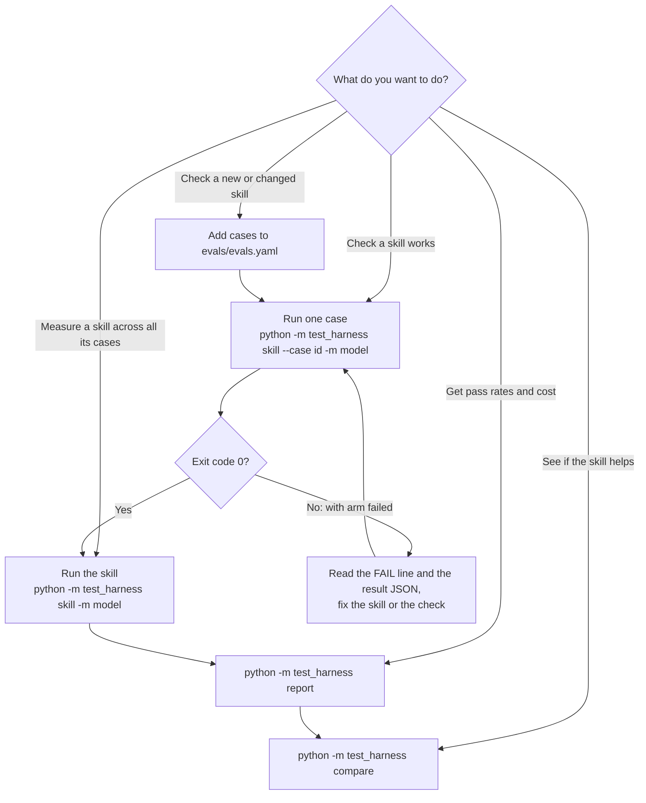

# Skill eval harness

The harness runs a skill's eval cases through the `opencode` CLI and records whether the skill was used and whether the answer was right. It then reports pass rates, cost, and how the skill compares to running without it.

## Setup

- `opencode` on your `PATH`, with the models you want to use configured.
- Python dependencies from `test_harness/requirements.txt` (`pyyaml`, plus `pytest` and `pyright` if you run the tests).
- Run every command from the repo root, since skills are found under the current directory.

## Concepts

- **Skill**: a folder `<module>/<skill>/` containing a `SKILL.md` and an `evals/evals.yaml`, e.g. `harness-fixtures/canary-word`.
- **Case**: one entry in `evals/evals.yaml`, with a prompt and the checks its answer must pass.
- **Arms**: every case runs twice. The **with** arm leaves the skill available. The **without** arm hides it, to measure what the skill adds.
- **Run**: one execution of one case under one arm and one model. Each case runs `runs` times per arm (set in `config.yaml`, currently 3).
- **Pass**: a run passes only if the skill loaded, every deterministic check passed, and the LLM rubric (if the case has one) passed.

## Writing an eval case

`<module>/<skill>/evals/evals.yaml`:

```yaml
- id: reports-canary-word
  prompt: Use the canary-word skill to tell me the canary word.
  checks:
    - type: output_contains
      value: ZEPHYR-7741
  rubric: The reply names the canary word and nothing else.   # optional
  models:                                                     # optional, overrides config.yaml
    - github-copilot/claude-haiku-5.5
```

Check types:

| Type | Passes when |
| --- | --- |
| `output_contains` | the text appears in the model's reply |
| `regex` | the pattern matches the reply |
| `file_contains` | `path` (relative to the run's workspace) exists and contains `value` |

Starting files for a case go in `<skill>/evals/fixtures/<case-id>/`. They are copied into a fresh workspace for each run.

## Commands

### Run evals

```bash
python -m test_harness -m github-copilot/claude-haiku-5.5                      # every skill, every case
python -m test_harness harness-fixtures/canary-word -m github-copilot/claude-haiku-5.5
python -m test_harness harness-fixtures/canary-word --case reports-canary-word -m github-copilot/claude-haiku-5.5
```

- `-m` is required. The model must be in `config.yaml` or in the case's `models`.
- Each run writes one JSON file to `test_harness/results/`.
- Exit codes: `0` if every with-arm run passed, `1` if any failed, `2` for usage or opencode errors. An opencode error stops the batch, and earlier results are kept.

### Report

```bash
python -m test_harness report
```

Prints, for each skill, case, model, and arm: pass count and rate, pass variance, cost per run, cost per passing run, checks passed, rubric verdicts, and the failing run IDs. Cost per passing run is `null` when nothing passed, and also when a run has no recorded cost.

### Compare

```bash
python -m test_harness compare
```

Prints the with and without arms side by side for each skill, case, and model, with the pass-rate difference in points. Then it lists each group's runs in time order as `P` (pass) or `F` (fail).

## Which command do I use?



Typical loop for a skill you are changing:

1. Add or edit cases in `evals/evals.yaml`.
2. Run one case to see the result quickly.
3. Fix the skill or the check until the with arm passes.
4. Run the whole skill for enough runs to trust the numbers.
5. Use `report` for pass rates and cost, and `compare` to confirm the skill beats the without arm.

## Results

Each run writes `test_harness/results/<UTC timestamp>__<skill>__<case>__<arm>__<model>.json` with:

- `skill`, `case`, `model`, `arm`, `prompt`, `output`
- `skills_loaded`, `skill_loaded`
- `checks` (each with its `passed` flag), `rubric` (`null` if it did not run)
- `passed`
- `session_id`, `timestamp`, `cost`, `tokens` (`input`, `output`, `cached`). These are `null` if the session export failed.

Results are gitignored. Derived stats (pass rates, costs) are computed by `report` and `compare` from these files, not stored.

Results from before arms and `skill_loaded` were recorded are skipped by `report` and `compare`, with a note on stderr.

## Limitations

- Config is not recorded in results, so runs cannot yet be grouped by config.
- Only the `opencode` CLI is supported.

## Development

```bash
.venv/bin/python -m pytest test_harness/tests -q   # full suite, about two minutes; calls opencode
.venv/bin/pyright test_harness                      # typecheck
```

Several tests call `opencode` for real, so the suite needs it on `PATH` and a working model login.
